# ASCII Christmas tree

[简体中文](README_CN.md)

A 480 × 480 interactive Christmas ornament for ESP-Mosaico. Drag to rotate, tap the star for a ding and gold dust, tap any material below for its own animation, sound and vibration, or tap a visiting snow animal to send it running. All scenery uses printable ASCII glyphs.

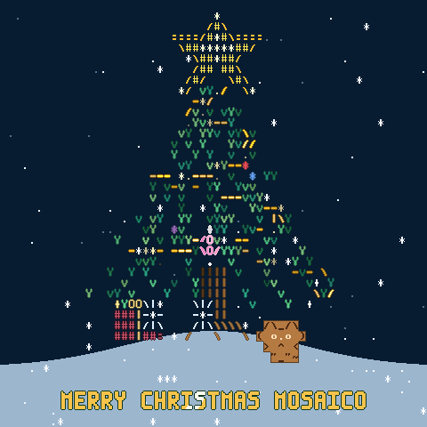

## Interactive materials

At most four materials hang on the tree and one gift of each colour sits on
the ground. A material hides whole while it is behind the tree, and the set
never changes while it is untouched: dragging, inertia and auto-rotation all
keep every material's kind and anchor. Only a tapped-out slot refills, only
during auto-rotation once its anchor has passed behind the tree, and at most
one slot per turn of the tree across materials and gifts together (a gift
first breaks apart). The backdrop is a flat night sky with a few dim `.`
points over a flat moonlit snow drift that rises under the tree, so the
trunk and gifts stand in the snow; the snow carries a few white glints.
Snow falls as white `.` and `*`, with at most two large `\|/ -*- /|\`
flakes at a time; tap a large flake and it bursts into small `.` and `*`
flakes that drift down. Tree materials have a lit edge so they stand out from
the foliage; the diamond is a solid teal gem. The foliage, trunk and roots
are drawn with a same-hue darker rim, so the tree reads bolder without any
fill. The gold garland spirals down the tree as a dash-dot line with a light
wave running down it and beads that twinkle and shed tiny sparks:
dashes that follow its slope with a dark amber rim, then a bright `*`
bead. The gift boxes stay open ASCII strokes in their own colour with a
bold dark outline and a gold ribbon. The greeting is drawn
in the canvas as bold 2x pixel capitals in foil gold: solid gold with a dark fir-green outline and a light glint that sweeps across every few
seconds. Everything on screen, materials, animals and effects alike,
is drawn from ASCII characters. Sounds are synthesized effects mixed over the music, which
ducks to about half while one plays; the motor patterns run on the device
only, alongside the sound. Close-ups below are simulator captures.

| Material   | Look                                      | Tap effect                                                                                                                                                                                                                                    | Sound (`main/audio/`)                                                                                                                                                                      | Vibration                         |
| ---------- | ----------------------------------------- | --------------------------------------------------------------------------------------------------------------------------------------------------------------------------------------------------------------------------------------------- | ------------------------------------------------------------------------------------------------------------------------------------------------------------------------------------------ | --------------------------------- |
| Bow        | 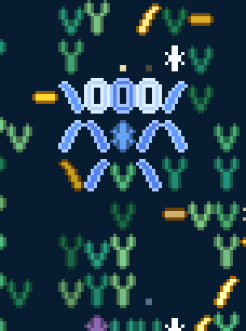        | Royal-blue bow; bursts into a cloud of coloured confetti that flutters down                                                                                                                                                                   | Fabric whoosh, `sfx_bow.wav`                                                                                                                                                               | 30%, two small pulses             |
| Bell       | 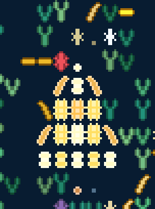       | Temple-bell shaped; shakes with two expanding sound rings, then drops and vanishes at the ground                                                                                                                                              | Jingle bell, `sfx_bell.wav`                                                                                                                                                                | 50%, three short pulses           |
| Candy cane | 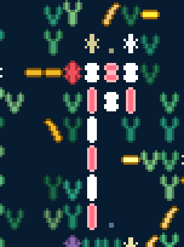 | Drops off its branch, bounces twice on the snow, then snaps into red and white candy chunks that hop and fade                                                                                                                                 | Candy crunch, `sfx_cane.wav`                                                                                                                                                               | 70%, one crisp pulse              |
| Bauble     | 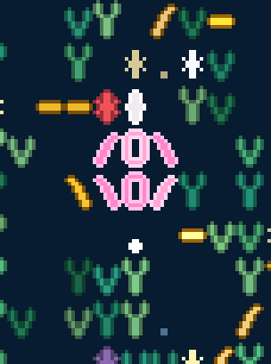     | Wobbles, then POP!: a glitter ring bursts out, five mini baubles bounce on the snow and the word `POP!` floats up                                                                                                                             | Glass shatter, `sfx_bauble.wav`                                                                                                                                                            | 80%, one heavy pulse              |
| Diamond    | 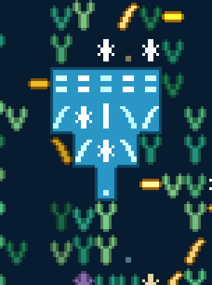    | Spirals up to the treetop with a prismatic sparkle trail; the star flashes white-hot and fires an ASCII starburst (eight `- | / \` light rays, a ring of coloured `*` and floating twinkles), then the gold helix lights up from the top down | Crystal twinkle, `sfx_star.wav`                                                                                                                                                            | 25%, one smooth 0.2 s pulse       |
| Stocking   | 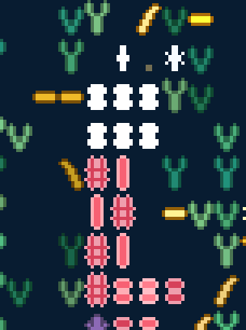   | Wobbles and lets a solid ASCII balloon out of the cuff that sways up off the top of the screen; the stocking vanishes                                                                                                                         | Triple pop, `sfx_stocking.wav`                                                                                                                                                             | 45%, three small hops             |
| Red gift   | 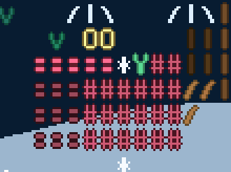   | A rocket climbs from the box and bursts above the treetop into coloured sparks that rain down; the box then breaks into ASCII pieces that scatter across the snow and fade                                                                    | Firework whistle and bang, `sfx_red_gift.wav`                                                                                                                                              | 40% for 0.3 s, then one 70% pulse |
| Blue gift  | 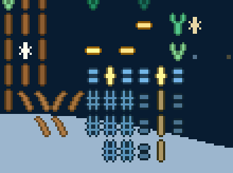  | The lid opens into a 12-second snow globe full of large `                                                                                                                                                                                     | / -*- /| flakes, and the box breaks into blue pieces that scatter across the snow; dragging then scatters the snow along the finger path (a gentle push applies to all snow, all the time) | Wind chimes, `sfx_blue_gift.wav`  |

The treetop star is a hand-drawn flat ASCII star that turns with the tree:
it narrows as the tree turns and shows edge-on as a thin vertical line. Tapping it keeps it in place: it rings with
`sfx_star_ding.wav` and sheds gold dust, with no vibration.

## Snow-ground animals

One animal at a time visits the snow in front of the tree every 20 to 45
seconds and idles with a gentle bob and an occasional blink. Each animal
is a front-facing ASCII face drawn over a solid body-colour fill, so it
hides the snow behind it (the squirrel's tail stays a slim line). Tap it,
or leave it alone for about 12 seconds, and it leaves: runners dash across
to the far side of the screen, the squirrel, reindeer and rabbit bounding
in hops and the cats running low; the groundhog ducks back into its snow
hole, which then closes. A tap adds crunchy snow steps
(`sfx_snow_step.wav`); animals never vibrate.

| Animal | Look | Run style |
|---|---|---|
| Squirrel | 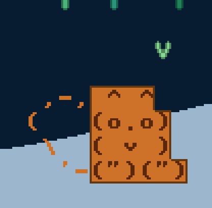 | Tail up, fast scamper with small hops |
| Reindeer | 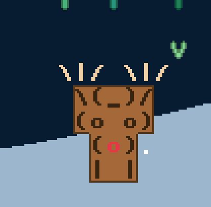 | Big bounding leaps |
| Rabbit | 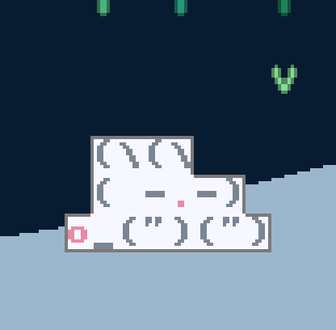 | Continuous hops |
| Coffee cat | 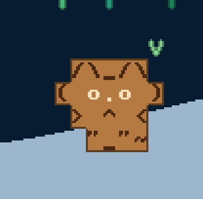 | Steady trot |
| Black cat | 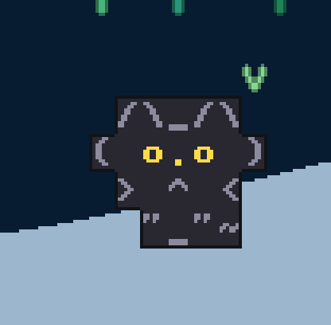 | Low, fast dash |
| Black-and-white cat | 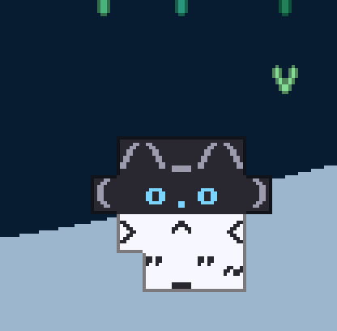 | Pouncing bounds |
| Grey cat | 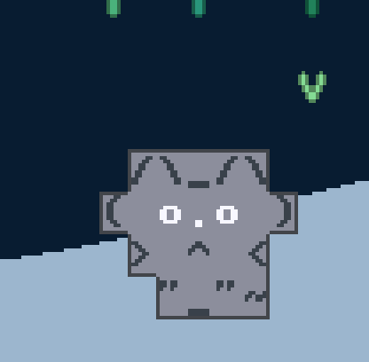 | High-stepping trot |
| Groundhog | 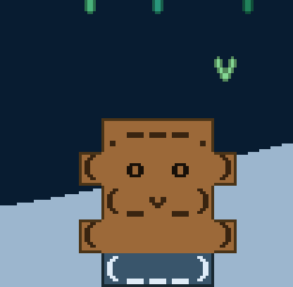 | Pops its head out of a snow hole; ducks back in and the hole closes |

## Volume panel

Press the board's AI key to open the volume panel with two sliders, MUSIC
for the background music and EFFECTS for the sound effects (both start at
60). Press the AI key again, or press anywhere outside the panel, to close
it; that closing touch never reaches the tree. Only where a touch starts
counts: a drag that starts on a slider keeps the panel open even if the
finger slides off it. Both volumes use the codec's
former -50 to 0 dB curve as separate software gains. In the simulator,
which has no AI key, start the backend with `TREE_SIM_VOLUME_PANEL=1` to
open the panel. Sound sources and regeneration: `main/audio/SOURCES.md`.

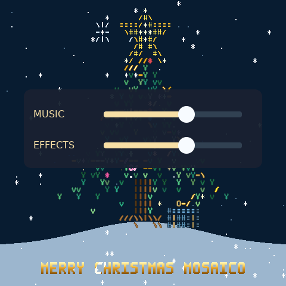

From the workspace root run:

```sh
python3 mosaico.py project sim --project projects/ascii_christmas_tree --interactive
```

The macOS simulator and device application loop the bundled 24-second music-box demo. The audio is locally synthesized for preview; distribution rights for the musical arrangement have not been obtained.

Application components:

- `components/app_hello`: shared projected tree, animation and touch controller.
- `components/app_display`: BSP-to-GSP display and optional touch policy.
- `main`: device startup and dependency composition only.
- `components/app_hello/host`: desktop adapter and its separate CMake build,
reusing the same controller and public header; excluded from the ESP32 build.
- `components/app_hello/ui/main.json`: authored scene; generated bindings and bundles stay in the build.

`project sim` discovers a unique scene under `components/*/ui/main.json` (or the
older root `ui/main.json`). With multiple scenes, select one using `--scene PATH`,
relative to the project. This previews only that scene; omit `--scene` to run the
PC backend and its compiled application behavior.

Dependency direction is `main -> app_hello -> ESP-GSP` and
`main -> app_display -> BSP/ESP-GSP`. Neither application component depends on
`main` or on its sibling. Public headers live in `include/`; private state stays
in implementation files. Each component README includes its contract and usage.

When adding behavior, keep `main` as a composition root. Add cohesive `app_*`
components only for independent responsibilities, declare public/private CMake
dependencies explicitly, and keep the graph acyclic. Avoid cross-module globals;
pass handles, context and value snapshots. Keep each public API comment within
three lines, describing its purpose and key preconditions/results. Put detailed
ownership, lifecycle, threading and timeout contracts in the component README;
document units and ranges beside fields.
Third-party dependencies retain upstream names. Pins and workspace overrides live
in `main/idf_component.yml` and the root CMake configuration. Apply local patches
in a dedicated dependency checkout and select it with `override_path`; never edit
`managed_components/` in place.

Git, editor and hook entry files stay at the root; format rules, project policy
and setup instructions live in `tools/quality/`. See its README to enable hooks.
The `tools/quality/policy.json` prefix rule checks local application component names.
Architecture and API semantics also require code review; formatter/static-analysis
success alone does not establish those contracts.
