# ASCII 圣诞树

[English](README.md)

一个用于 ESP-Mosaico 的 480 × 480 交互式圣诞挂饰。拖动可以旋转，点击树顶星星会发出叮当声并洒下金粉，点击下方任意饰品会触发它各自的动画、音效和振动，点击来访的雪地小动物则会把它送跑。所有画面都使用可打印的 ASCII 字符绘制。

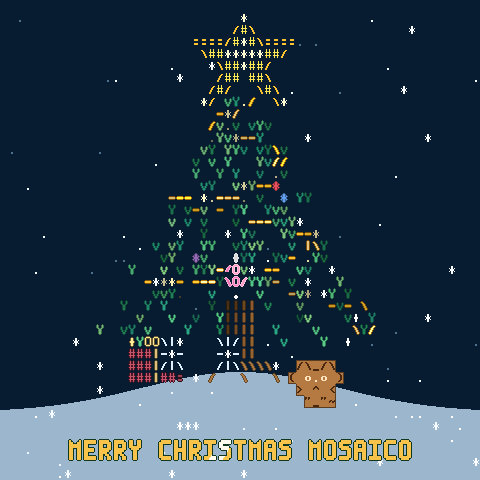

## 互动饰品

树上最多挂四个饰品，地面上每种颜色各放一个礼物盒。饰品转到树后时会被整件隐藏。只要没有被点击，这组饰品就不会变化：拖动、惯性和自动旋转都会保留每个饰品的种类和锚点。只有被点击用掉的位置才会补上新饰品，而且只在自动旋转期间、其锚点转到树后之后才补，整棵树每转一圈，饰品和礼物加起来最多补一个位置（礼物会先碎开）。背景是平坦的夜空，点缀几颗暗淡的 `.`，下方是一片被月光照亮的平坦雪坡，雪坡在树下隆起，让树干和礼物立在雪中，雪面上还有几点白色闪光。雪以白色的 `.` 和 `*` 飘落，同一时间最多有两片大雪花 `\|/ -*- /|\`，点击大雪花，它会碎成小小的 `.` 和 `*` 雪花飘落下来。树上的饰品带有一圈亮边，能从枝叶中凸显出来，钻石则是一颗实心的青色宝石。枝叶、树干和树根都用同色系的深色描边绘制，让树在没有任何填充的情况下也更醒目。金色花环以点划线螺旋环绕树身向下延伸，一道光波沿着花环向下流动，串珠闪烁着并洒下细小火花：先是带深琥珀色描边、顺着螺旋斜率的短划，然后是一颗明亮的 `*` 串珠。礼物盒保持各自颜色的开放式 ASCII 线条，带粗深色轮廓和金色丝带。祝福语直接画在画布上，使用烫金色的粗体 2 倍像素大写字母：实心金色，带深冷杉绿描边，每隔几秒有一道亮光扫过。屏幕上的一切，饰品、动物和特效，全都由 ASCII 字符绘制。音效为合成效果，混在音乐之上播放，播放期间音乐会降到约一半音量，马达振动模式仅在设备上与音效同步运行。下方特写均为模拟器截图。

| 饰品 | 外观 | 点击效果 | 音效（`main/audio/`） | 振动 |
| ---------- | ----------------------------------------- | --------------------------------------------------------------------------------------------------------------------------------------------------------------------------------------------------------------------------------------------- | ------------------------------------------------------------------------------------------------------------------------------------------------------------------------------------------ | --------------------------------- |
| 蝴蝶结 | 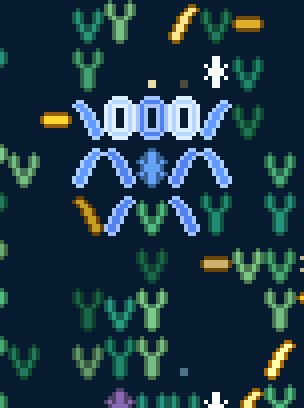 | 宝蓝色蝴蝶结，碎成一团彩色纸屑飘落下来 | 布料挥动声，`sfx_bow.wav` | 30%，两次小脉冲 |
| 铃铛 | 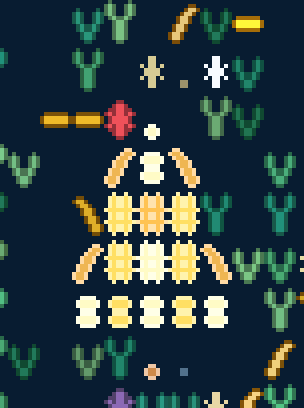 | 寺庙钟形，摇晃着扩散出两圈声波，然后掉落到地面消失 | 铃儿响叮当，`sfx_bell.wav` | 50%，三次短脉冲 |
| 拐杖糖 | 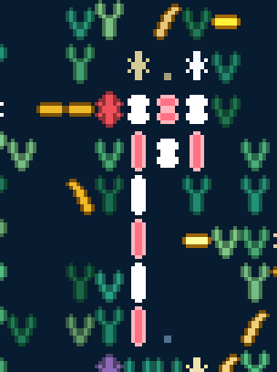 | 从树枝上掉下来，在雪地上弹跳两次，然后碎成红白相间的糖块，蹦跳着淡出 | 糖果脆裂声，`sfx_cane.wav` | 70%，一次干脆的脉冲 |
| 彩球 | 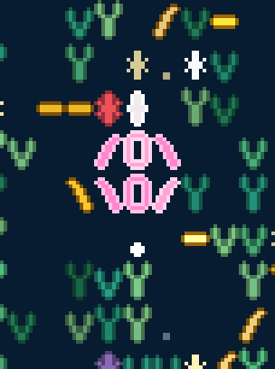 | 摇晃几下，然后 POP!：一圈闪粉爆开，五颗迷你彩球在雪地上弹跳，`POP!` 字样向上飘起 | 玻璃碎裂声，`sfx_bauble.wav` | 80%，一次强劲脉冲 |
| 钻石 | 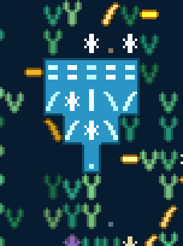 | 沿螺旋上升到树顶，拖着一道棱彩闪光轨迹，树顶星星闪成炽白色并射出一团 ASCII 星芒（八道 `- \| / \` 光线、一圈彩色 `*` 和飘浮的闪光），然后金色螺旋从上到下依次点亮 | 水晶闪烁声，`sfx_star.wav` | 25%，一次平滑的 0.2 秒脉冲 |
| 圣诞袜 | 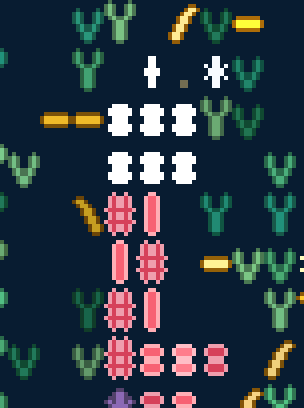 | 摇晃着从袜口放出一只实心 ASCII 气球，气球摇摆着升出屏幕顶部，圣诞袜随之消失 | 三连爆声，`sfx_stocking.wav` | 45%，三次小跳 |
| 红色礼物 | 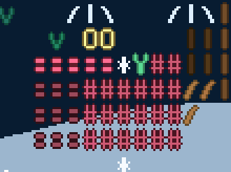 | 一支火箭从盒中升起，在树顶上方炸成彩色火花如雨落下，然后盒子碎成 ASCII 碎片，散落在雪地上淡出 | 烟花呼啸与爆响，`sfx_red_gift.wav` | 40% 持续 0.3 秒，然后一次 70% 脉冲 |
| 蓝色礼物 | 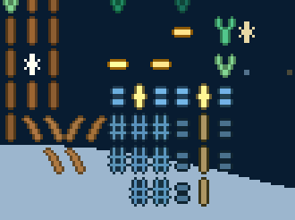 | 盒盖打开，变成一个持续 12 秒、满是大雪花的雪景球，盒子碎成蓝色碎片散落在雪地上，之后拖动会沿着手指路径拨散雪花（所有雪花始终都会受到轻柔的推力） | 风铃声，`sfx_blue_gift.wav` |

树顶星星是一颗手绘的扁平 ASCII 星星，会随树一起转动：树转动时它会变窄，侧对时会变成一条细细的竖线。点击它时它会留在原地：发出 `sfx_star_ding.wav` 的叮当声并洒下金粉，没有振动。

## 雪地小动物

每隔 20 到 45 秒，会有一只小动物来到树前的雪地上，一次只来一只，它会轻轻上下浮动待着，偶尔眨一下眼。每只动物都是一张正面 ASCII 脸，画在实心的身体颜色填充之上，所以会遮住身后的雪（松鼠的尾巴保持一条细线）。点击它，或者放着不管约 12 秒，它就会离开：奔跑型的会横穿跑到屏幕另一侧，松鼠、驯鹿和兔子一蹦一跳，猫科动物则贴地奔跑，土拨鼠会缩回它的雪洞，洞口随后合上。点击还会加上脆脆的踏雪声（`sfx_snow_step.wav`），动物永远不会触发振动。

| 动物 | 外观 | 奔跑方式 |
|---|---|---|
| 松鼠 | 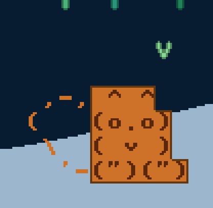 | 尾巴竖起，小步快跑带小跳 |
| 驯鹿 | 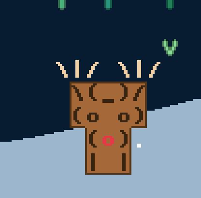 | 大幅蹦跳 |
| 兔子 | 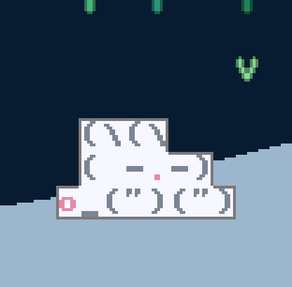 | 连续跳跃 |
| 咖啡猫 | 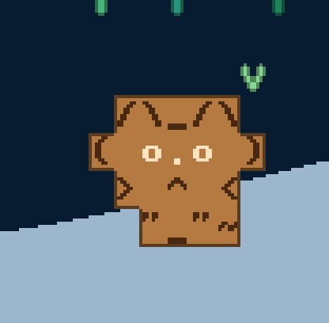 | 稳定小跑 |
| 黑猫 | 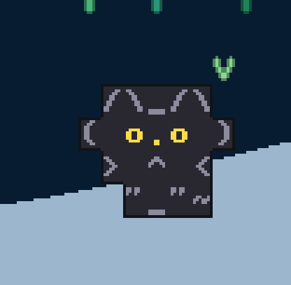 | 贴地快速冲刺 |
| 黑白猫 | 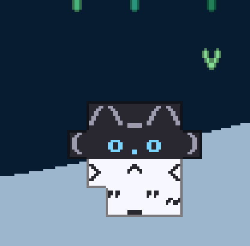 | 扑跃式蹦跳 |
| 灰猫 | 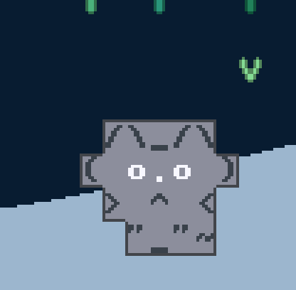 | 高抬腿小跑 |
| 土拨鼠 | 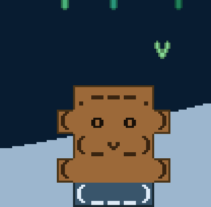 | 从雪洞里探出头，缩回去后洞口合上 |

## 音量面板

按开发板上的 AI 按键打开音量面板，面板上有两个滑块，MUSIC 控制背景音乐，EFFECTS 控制音效（两者初始值都是 60）。再次按 AI 按键，或者按面板外的任意位置，即可关闭面板，这次关闭的触摸不会传给圣诞树。只看触摸起始的位置：在滑块上开始的拖动，即使手指滑出滑块，也会保持面板打开。两个音量都使用编解码器原先的 -50 到 0 dB 曲线，作为独立的软件增益。在没有 AI 按键的模拟器中，启动后端时设置 `TREE_SIM_VOLUME_PANEL=1` 即可打开面板。声音来源与重新生成方法见 `main/audio/SOURCES.md`。

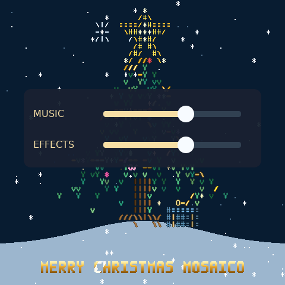

在工作区根目录运行：

```sh
python3 mosaico.py project sim --project projects/ascii_christmas_tree --interactive
```

macOS 模拟器和设备应用会循环播放内置的 24 秒八音盒演示音频。该音频为本地合成的预览版本，尚未取得这段音乐编曲的发行授权。

应用组件：

- `components/app_hello`：共享的投影圣诞树、动画和触摸控制器。
- `components/app_display`：BSP 到 GSP 的显示适配和可选的触摸策略。
- `main`：仅负责设备启动和依赖组装。
- `components/app_hello/host`：桌面适配器及其独立的 CMake 构建，复用同一个控制器和公共头文件，不参与 ESP32 构建。
- `components/app_hello/ui/main.json`：手工编写的场景，生成的绑定和打包文件保留在构建目录中。

`project sim` 会在 `components/*/ui/main.json` 下查找唯一的场景（或旧式的根目录 `ui/main.json`）。如果有多个场景，用 `--scene PATH` 选择一个，路径相对于工程。这样只预览选中的场景，省略 `--scene` 则运行 PC 后端及其编译后的应用行为。

依赖方向是 `main -> app_hello -> ESP-GSP` 和 `main -> app_display -> BSP/ESP-GSP`。两个应用组件都不依赖 `main`，也不依赖彼此。公共头文件放在 `include/` 中，私有状态保留在实现文件里。每个组件的 README 都包含其契约和用法。

添加行为时，保持 `main` 作为组装根。只有职责独立时才添加内聚的 `app_*` 组件，显式声明公共/私有 CMake 依赖，并保持依赖图无环。避免跨模块全局变量，传递句柄、上下文和值快照。每个公共 API 注释控制在三行以内，说明其用途和关键前置条件/结果。把详细的所有权、生命周期、线程和超时契约写在组件 README 中，在字段旁注明单位和范围。

第三方依赖保留上游名称。版本锁定和工作区覆盖配置放在 `main/idf_component.yml` 和根 CMake 配置中。在专用的依赖检出目录中打本地补丁，并用 `override_path` 选用它，不要直接编辑 `managed_components/`。

Git、编辑器和钩子的入口文件保留在根目录，格式规则、工程策略和设置说明放在 `tools/quality/` 中。查看其 README 以启用钩子。`tools/quality/policy.json` 中的前缀规则会检查本地应用组件的命名。架构和 API 语义同样需要代码评审，仅靠格式化/静态分析通过并不能保证这些契约成立。
